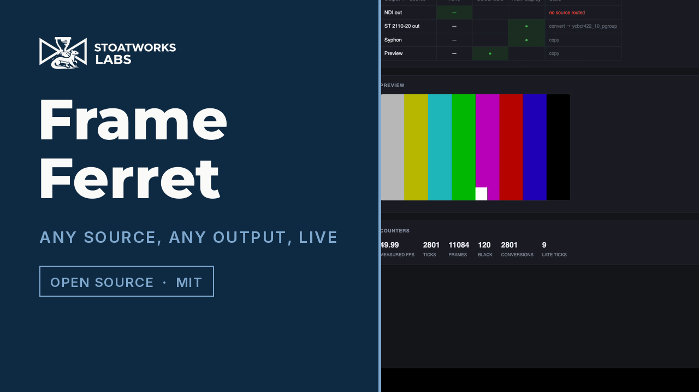

# Frame Ferret

> **AI-assisted project.** This codebase was created with [Claude](https://claude.com/claude-code)
> (Anthropic), directed and reviewed by a human author. Every transport that's built has been
> checked against an implementation that isn't this code, and DeckLink output has run on a real
> Duo 2. The UVC virtual camera, Spout, DeckLink capture, HTML output and 2110
> audio and ancillary aren't written yet, and SRT doesn't run on Windows yet; the virtual display is built and experimental on macOS and Windows. The details, including what each check was against,
> are under [Status](#status).

A virtual capture card, in software. It's one application that acts as an **NDI, OMT, SRT and
ST 2110 endpoint**, sending and receiving, on whichever network interface you choose. It can
capture this machine's screen, and it shows up to other software as a camera, a shared GPU
surface, an SDI output or a web overlay.

The [project page](https://stoatworks-labs.com/software/frame-ferret/) has the downloads, the [user guide](https://stoatworks-labs.com/software/frame-ferret/guide/) and the video.

The idea is that a protocol is just a port on a router. Anything can be a source, anything can be
a sink, and the crosspoint in the middle doesn't care which is which.

[](https://www.youtube.com/watch?v=7jppEKgBDLk)

*Sixty seconds of it running: the crosspoint being switched live, with NDI, ST 2110 and Syphon all publishing.*

## What it is meant to do

**As a source: things it can pick up**

- Display, window, application and region-of-interest capture
- A virtual display that other applications can be dragged onto
- Syphon (macOS) and Spout (Windows) servers published by other applications
- Incoming NDI, OMT, SRT and ST 2110 streams
- DeckLink capture input

**As a sink: things it can present to**

- A **UVC capture device**, so Zoom, Teams, OBS and anything else sees it as a
  camera
- A Syphon / Spout server for Resolume, OBS, VDMX and similar
- DeckLink cards, straight out to SDI
- An HTML page, to bring into OBS as a browser-source overlay
- Outgoing NDI, OMT, SRT and ST 2110

**Everywhere**

- Explicit network interface binding, because a stream on the wrong NIC gets diagnosed on site
  as a network fault, and the network team gets the blame. NDI is the exception: its C API has
  no interface parameter at all, so Frame Ferret warns you rather than pretending the setting
  applied
- A system tray launcher, configured through a web browser, in the same shape
  as [WebLinked](https://github.com/stoatworks-labs/weblinked)

## Status

What's built, what's been run, and what hasn't been started. I'll keep this table straight as it
grows.

| Area | State |
|---|---|
| Node model, crosspoint router | **Built and tested.** 36 checks |
| Exact rational rates and tick deadlines | **Built and tested.** 40 checks |
| Pixel format model | **Built and tested.** 33 checks |
| Pixel conversion (BGRA/RGBA/UYVY/YUY2/v210) | **Built and tested.** 113 checks, including a colour-bar round trip verified by pixel readback |
| Frame loop / engine | **Built, tested and run.** 95 checks; 9049 ticks at 50 fps with zero late |
| Config loading | **Built and tested.** 57 checks |
| Interface enumeration and binding | **Built and runs.** 81 checks, verified against this machine's real NICs. The count varies by machine — the suite walks whatever it finds |
| Test-pattern source, preview sink | **Built and run** |
| Web control page + JSON API | **Built and driven in a browser.** Crosspoint clicks verified against the API |
| CLI (`run`, `selftest`, `interfaces`, `kinds`) | **Runs** |
| **NDI send and receive** | **Built and verified against a separate implementation.** Runtime-loaded, never linked |
| **OMT send and receive** | **Built and verified**, against oxbow and macOS `dns-sd`. Runtime-loaded. On Windows, run both ways against a separate OMT implementation on a Mac — see below |
| **SRT transport** | **Built and proven over loopback** — caller/listener, real interface binding, latency, passphrase, stream id. The SRT node built on it is in the next two rows |
| **SRT receive (decode)** | **Built and verified end to end** against an independent Rust SRT sender — all seven SMPTE bars decoded correctly. **Not on Windows yet:** there the node can't start ffmpeg, and says so |
| **SRT send (encode)** | **Built and verified end to end** — all eight bars within 2 code values through H.264, read back by independent tools. **Not on Windows yet**, for the same reason |
| **External codec via ffmpeg** | **Built and verified.** Points at an install you already have; nothing linked, nothing bundled |
| **DeckLink output** | **Run on a real Duo 2**: 1080p50 in v210, 2531 frames with **0 late and 0 dropped** by the card's own count. Pixels on the wire not yet checked — that needs an SDI loop cable |
| **ST 2110-20 send and receive** | **Built and verified against GStreamer's RFC 4175 implementation**, both directions, within 2 code values. Wide-profile sender, system-clocked — see below |
| ST 2110-30 audio, -40 ancillary | **Not started** |
| **Display, window, application and ROI capture** (macOS) | **Built and run.** ScreenCaptureKit; region of interest is a source rect, so a crop costs nothing |
| **Display and ROI capture** (Windows) | **Built and run on a Windows VM.** DXGI Desktop Duplication, followed across renumbering. Window and application capture aren't written for Windows (they need Windows.Graphics.Capture) |
| UVC virtual camera | **Not started.** Needs an embedded provisioning profile, which the fleet's release harness does not yet produce — see [docs/03-os-extensions.md](docs/03-os-extensions.md) |
| **Virtual display** (macOS) | **Built, experimental — private API.** A real display other apps can output to; route it to any sink. Run with Resolume Arena's Advanced Output into an OMT sender: 60.0 fps, no frame out of order, bars within 3 levels — see [docs/03-os-extensions.md](docs/03-os-extensions.md) |
| **Virtual display** (Windows) | **Built, experimental, since v0.4.0 — on a signed driver you install.** Frame Ferret ships no driver; it claims a display of VirtualDrivers' Virtual Display Driver (VDD), sets its mode and captures it. Run on a GPU-less Windows 11 VM into an NDI sender: 60.1 fps received by a separate process, no frame out of order, bars within 1 level, but only 27 new pictures a second, because that VM's desktop composes about 40. Whole rates only. Never run on a machine with a GPU, or with Resolume on Windows |
| **Syphon output** (macOS) | **Built and verified against Resolume's Syphon 5** — a different implementation from the Syphon 6 sources vendored here |
| DeckLink capture, Spout, HTML output | **Not started** |
| Desktop launcher | **Shipped since v0.1.1** (ba8856f). The fleet's av-launcher shell with the binary embedded: pick an interface and a port, press Start, and it opens the control page. `.dmg` on macOS, NSIS installer on Windows, `.deb`/`.rpm` on Linux. It's a window plus a tray icon (in the menu bar on a Mac): closing the window hides it to the tray and leaves the engine running |
| Windows, Linux | **Built and self-tested by CI**, all three platforms green. On Windows, display capture and the virtual display have also run in a signed-in session of a VM, and OMT has run both ways between that VM and a Mac (above). SRT doesn't run on Windows yet. Nothing else has run interactively on either, and no hardware path exists on them |

### What has actually been observed

Running `frame-ferret run` on this Mac: colour bars generated at 1280x720p50, routed through the
crosspoint, converted, and shown live on the control page. Over one 9049-tick run: **4507 frames
delivered + 4542 black = 9049**, exactly one action per sink per tick, zero late ticks, 49.99 fps
measured.

Unrouting the sink from the browser turned the output black *and kept it running at 50 fps*,
reporting `no source routed`. That's the rule this whole program is built around, seen happening
rather than just claimed.

**OMT, both directions.** Sending is confirmed by macOS's own `dns-sd`, which browses `_omt._tcp`
and lists `MAC (FerretOMT)` on four interfaces, and by oxbow receiving at `omt://127.0.0.1:6400`
and decoding all eight bars **within 2 code values**. That's much closer than NDI's 13, because
OMT carried BGRA rather than compressing it. Receiving is a Frame Ferret round trip at a clean
50 fps.

**NDI, both directions, against an independent implementation.** Sending:
[oxbow](https://github.com/stoatworks-labs/oxbow) discovers `MAC (FerretTest)`, receives
1280x720p50, and all eight colour bars decode in the right order with the right hues. Receiving:
Frame Ferret takes oxbow's stream at 59.97 fps, 344 frames with 2 black (the ticks before
connection), as a `copy` in UYVY with no conversion.

One note on that measurement: saturated blue comes back as 178 rather than 191. That's NDI's
SpeedHQ compression, not this code; oxbow's own sender through the same round trip lands on
exactly the same 178. The control experiment mattered, because the number on its own would have
looked like a bug.

**How SRT uses ffmpeg.** NDI and OMT carry raw frames, so a node is a thin wrapper over the SDK.
SRT carries an MPEG transport stream of *compressed* video, so it needs a codec. Frame Ferret runs
**ffmpeg as a subprocess** rather than linking it:

- **You point at the install you already have.** The node's `"ffmpeg"` setting,
  `$FERRET_FFMPEG`, `$PATH`, or the usual locations, in that order. An explicit path that's wrong
  is an error, never a silent fallback to some other ffmpeg.
- **No ABI coupling.** libavcodec's structs change between major versions, and mirroring them by
  hand would be far more fragile than NDI, OMT or libsrt, which all expose flat C ABIs on purpose.
- **Licensing stays simple.** ffmpeg is LGPL and commonly built as GPL with libx264. A separate
  process over a pipe doesn't raise any question an MIT codebase needs to answer.
- **CI keeps building**, with no ffmpeg on the runners and nothing to detect.

**Not on Windows yet.** Starting that subprocess is written for macOS and Linux only. On Windows
an SRT node reports *SRT needs an external codec, and running one is not implemented on this
platform yet* and stays unavailable, whichever ffmpeg and `srt.dll` are installed. That was seen
on winlab with ffmpeg 8.1 and libsrt 1.5.6 both in place.

Hardware encoders win where there are any; on this Mac it picks `h264_videotoolbox` over
`libx264`.

**SRT receive, verified end to end.** Nothing already on the machine could act as a sender.
Homebrew's ffmpeg has no SRT compiled in, `srt-file-transmit` speaks SRT's *stream* API (which the
live-mode receiver here correctly rejects), and `srt-live-transmit` only bridges UDP↔SRT. So
`tools/srtsend` was written against **srt-tokio**, the pure-Rust SRT stack `srt-router` uses.
That's a completely different implementation from the libsrt Frame Ferret binds, which is what
makes the result mean something.

Frame Ferret received all **129,156 bytes byte-for-byte**, decoded them through an external
ffmpeg, and rendered all seven SMPTE bars at the right levels in the right channel order.

**SRT send, verified end to end.** Frame Ferret encodes with `h264_videotoolbox`, muxes to MPEG-TS
and listens on SRT; `srt-live-transmit` pulls the stream and ffmpeg decodes it back to a still.
All eight bars land **within 2 code values**, through a lossy H.264 round trip.

Getting there fixed two actual colour bugs. Both had left the hues and bar order perfect while the
values were wrong, which is the sneakiest way a colour fault can show up:

- **Range.** An RGB source was encoded as full-range YCbCr and the receiver expanded it again, so
  green came back at 240 instead of 191. `convert()` now reports the range it produced and
  normalises RGB sources to narrow, which is what every transport here expects.
- **Matrix.** rawvideo carries no colorimetry, so ffmpeg guesses **BT.601 below 720 lines**.
  Sending it 709 data at 640x360 without saying so skewed every saturated colour while white and
  black stayed exact. Both input and output are now tagged explicitly.

SRT is the **only transport here that can actually bind to a chosen interface**: `srt_bind()`
takes a real address, where NDI and OMT have no such parameter at all.

**Syphon, verified by a consumer that isn't this code.** WebLinked's `syphon_probe` links
**Resolume Arena's bundled Syphon 5**, not the Syphon 6 server sources vendored here, and is
started *after* Frame Ferret, which is the case the main-thread trap breaks. It finds
`Frame Ferret (frame-ferret)`, receives a 1280x720 frame, and reads BGRA `191 0 191` at x=640,
which is magenta: the right colour, in the right channel order, at the right place in the bars.

**DeckLink, on real hardware.** A Duo 2 in the 2-sub-device half-duplex profile, output on
connector 1 at 1920x1080p50 as **v210**. The card's own completion callback reports **2531
frames, 0 late, 0 dropped** over ~50 seconds, with the engine holding 49.98 fps. What *isn't*
verified is the picture on the wire: that needs an SDI cable looping an output back to an input,
and there wasn't one to hand.

Getting there meant making the conversion just over twice as fast. BGRA to v210 at 1080p cost
26.6 ms (a 38 fps ceiling), so the card ran at 34 fps with a third of its ticks late. Folding the
colour coefficients and then fusing RGB to v210 past the shared intermediate took it to **12.7 ms**.

**Audio now follows the same crosspoint as video.** The test pattern sends a 1 kHz tone at
-20 dBFS alongside the bars, and it travels the routes the video does. Across NDI: 4478 audio
frames sent, and a second Frame Ferret received and routed 287 of them back through libndi's own
encode and decode. Both ends are this codebase, so that's not a fully independent check, but
libndi sits in the middle, and a wrong planar layout wouldn't survive it.

**Screen capture, on this machine.** A display at 1280x720p30 gave 175 frames of real desktop
content, a named window gave 136 frames with zero black, and two different regions of the same
display came out as different pictures, which proves the crop is applied rather than ignored.

Two things about it worth knowing. **Without Screen Recording permission, a capture starts
successfully and delivers black frames forever**, with no error, no callback and nothing in any
log. Thanks, macOS. So permission is checked up front and reported as the reason a node failed.
And a plain C++ CLI has to call `NSApplicationLoad()` before touching CoreGraphics: *window*
capture asserted with `CGS_REQUIRE_INIT` on first run while *display* capture worked, because only
the window path reaches that code.

**The virtual display, on Windows.** On winlab, a Windows 11 VM with no GPU (Microsoft Basic
Render Driver, two cores), with VDD 25.7.23 installed. A separate bench process put a counter test
card full screen on VDD's display and judged what came back:

| Route | Delivered | New pictures | Out of order | Bars |
| --- | --- | --- | --- | --- |
| Node in-process, 1080p60 | latest frame | 28.9 a second | none | exact |
| Node → NDI sender → another process, 1080p60 | 60.1 fps | 26.9 a second | none | within 1 level |
| Raw Desktop Duplication on the same display (no Frame Ferret) | — | 29.6 a second | — | — |

The ceiling is the VM, not the node: its desktop composes only about 40 times a second, and the
copy to memory takes the rest out of two cores that DWM is also rendering on in software. A mode
VDD didn't list (1600x900 at 30) was added to its settings, VDD reloaded, and the capture
followed the renumbered display. **59.94 can't be had:** VDD lists the mode, but Windows never
offers it (asked for, it's `BADMODE`), so a fractional rate runs at the whole rate above it and
says so. A VDD reload during capture broke VDD's device once in three tries; restarting it in
Device Manager brought the display back and the capture picked it up.

**OMT on Windows, against a separate implementation.** The same VM, with resolume-omt's
`omttest` on a Mac at the other end. The Mac was away from the VM's network that day, so both
directions went through SSH tunnels. `omttest`'s 1080p60 counter card went into Frame Ferret's
OMT receiver on Windows and back out of its OMT sender to `omttest --probe` on the Mac: no frame
out of order, the right way up, and the bars within 2 levels, the same as reading the card
directly. It's also the first time Frame Ferret's OMT *receiver* has been fed by something
other than Frame Ferret.

Only 16.6 pictures a second made it back. On the way in alone, a bench on the VM counted 20.7
distinct pictures a second while Frame Ferret's engine held 59.9 fps, so that's the tunnel and
two cores, not a product number. NDI between two machines, and OMT over a real network, haven't
been run on Windows yet.

**ST 2110-20, both directions, against an independent implementation.** GStreamer's
`rtpvrawdepay` decoded 143 frames of Frame Ferret's stream with a worst channel error of **1 code
value**; Frame Ferret decoded 196 frames from GStreamer's `rtpvrawpay` within **2**. ST 2110-20 is
RFC 4175 with constraints, so a conformant RFC 4175 implementation is a proper check rather than
this repo agreeing with itself.

2110 is also the **only** transport here that binds an interface properly and has to: multicast
send needs an explicit egress interface, and a join is keyed on the interface *index*, because two
interfaces can hold the same address after a DHCP reshuffle. The SDP is served through the control
API, since pasting one in is how most 2110 equipment gets configured.

**What this isn't.** It's a **wide-profile sender** (`a=TP=2110TPW`, and it says so), clocked
from the system monotonic clock rather than a PTP servo, and frames are never marked `ptpLocked`.
Narrow profile needs hardware transmit pacing, and macOS has no supported hardware timestamping
path at all. See [docs/02-st2110.md](docs/02-st2110.md); that was known before a line was written,
and nothing since has changed it.

Two constraints turned up while scoping, and both are written up in full because they shape
everything downstream:

- **ST 2110-20 is a wide-profile sender.** Narrow profile needs hardware transmit pacing, and
  macOS also has no supported hardware timestamping path for PTP. Wide is in spec and widely
  accepted, but it isn't the same claim. [docs/02-st2110.md](docs/02-st2110.md)
- **macOS has no public virtual display API.** The only route is private CoreGraphics classes,
  which the virtual display node uses, looked up at run time so a macOS without them loses that
  node and nothing else. Window and application capture cover dragging an app onto a surface;
  the virtual display is for software that can only output to a display, such as Resolume's
  Advanced Output. [docs/03-os-extensions.md](docs/03-os-extensions.md)
- **A display on Windows needs a driver Microsoft has signed**, and signing one needs an EV
  certificate and a Partner Center account. So Frame Ferret drives VirtualDrivers' Virtual Display
  Driver (MIT, signed through the SignPath Foundation), which you install once, rather than ship
  an unsigned driver nobody could load.

<!-- downloads:start -->

## Download

**[v0.4.0](https://github.com/stoatworks-labs/frame-ferret/releases/tag/v0.4.0)** — prebuilt for macOS, Windows and Linux. Pick your platform:

<details>
<summary><b>macOS</b> — Universal (Apple Silicon + Intel)</summary>

| Build | Download | Size |
| --- | --- | --- |
| Universal (Apple Silicon + Intel) · .dmg disk image | [`frame-ferret-0.4.0-macos-universal.dmg`](https://github.com/stoatworks-labs/frame-ferret/releases/download/v0.4.0/frame-ferret-0.4.0-macos-universal.dmg) | 8.5 MB |
| Universal (Apple Silicon + Intel) · .pkg installer | [`frame-ferret-0.4.0-macos-universal.pkg`](https://github.com/stoatworks-labs/frame-ferret/releases/download/v0.4.0/frame-ferret-0.4.0-macos-universal.pkg) | 8.5 MB |
| Universal (Apple Silicon + Intel) · .zip archive | [`frame-ferret-0.4.0-macos-universal.zip`](https://github.com/stoatworks-labs/frame-ferret/releases/download/v0.4.0/frame-ferret-0.4.0-macos-universal.zip) | 546 KB |

</details>

<details>
<summary><b>Windows</b> — x64</summary>

| Build | Download | Size |
| --- | --- | --- |
| x64 · .exe installer | [`Frame.Ferret_0.4.0_x64-setup.exe`](https://github.com/stoatworks-labs/frame-ferret/releases/download/v0.4.0/Frame.Ferret_0.4.0_x64-setup.exe) | 2.8 MB |
| x64 · .zip archive | [`frame-ferret-0.4.0-windows-x86_64.zip`](https://github.com/stoatworks-labs/frame-ferret/releases/download/v0.4.0/frame-ferret-0.4.0-windows-x86_64.zip) | 262 KB |

</details>

<details>
<summary><b>Linux</b> — x64</summary>

| Build | Download | Size |
| --- | --- | --- |
| x64 · .deb package (Debian/Ubuntu) | [`Frame.Ferret_0.4.0_amd64.deb`](https://github.com/stoatworks-labs/frame-ferret/releases/download/v0.4.0/Frame.Ferret_0.4.0_amd64.deb) | 5.7 MB |
| x64 · .rpm package (Fedora/RHEL) | [`Frame.Ferret-0.4.0-1.x86_64.rpm`](https://github.com/stoatworks-labs/frame-ferret/releases/download/v0.4.0/Frame.Ferret-0.4.0-1.x86_64.rpm) | 5.7 MB |
| x64 · .zip archive | [`frame-ferret-0.4.0-linux-x86_64.zip`](https://github.com/stoatworks-labs/frame-ferret/releases/download/v0.4.0/frame-ferret-0.4.0-linux-x86_64.zip) | 443 KB |

</details>

All builds, checksums and release notes: [github.com/stoatworks-labs/frame-ferret/releases](https://github.com/stoatworks-labs/frame-ferret/releases).

macOS builds are signed and notarised and open normally. The Windows builds are unsigned, so SmartScreen warns once.

<!-- downloads:end -->

Every transport is loaded at run time rather than linked, so a downloaded build starts on a
machine with none of them installed and reports each one as unavailable, with a sentence saying
where to get it. The exception is DeckLink, which needs Blackmagic's SDK at build time, so it's
left out of the published builds entirely. For SDI, build from source with
`-DDECKLINK_SDK_DIR=…`.

## Build

```bash
cmake -S . -B build -DCMAKE_BUILD_TYPE=Release && cmake --build build -j8
```

```bash
cd build && ctest --output-on-failure
```

Run it, then open <http://127.0.0.1:8740/>:

```bash
./build/frame-ferret run
```

Prove the whole frame path without a network or any hardware:

```bash
./build/frame-ferret selftest
```

```bash
./build/frame-ferret interfaces
```

Send colour bars as NDI, then find them from any NDI receiver:

```bash
./build/frame-ferret run --config config/ndi-send.json
```

`config/example.json` is a minimal working configuration. `config/not-yet-implemented.json` shows
the shape a real one will take. It starts today and reports every unbuilt node as unavailable,
which is what it's meant to do.

## Documentation

- [docs/01-architecture.md](docs/01-architecture.md): the crosspoint model, the plan-every-sink
  invariant, and why pixel formats travel with frames
- [docs/02-st2110.md](docs/02-st2110.md): what full 2110 conformance costs
- [docs/03-os-extensions.md](docs/03-os-extensions.md): virtual camera and virtual display, per
  platform
- [docs/diagnostics.md](docs/diagnostics.md): the log, the crash report and the bundle to attach to
  a bug report
- [AGENTS.md](AGENTS.md): onboarding for whoever picks this up next

<!-- attributions:start -->
This project is built on other people's work — see [ATTRIBUTIONS.md](ATTRIBUTIONS.md).
<!-- attributions:end -->

## Licence

MIT.

NDI® is a registered trademark of Vizrt NDI AB. This repository contains no NDI
libraries; the runtime is loaded from whatever is installed on the machine. See
[ndi.video](https://ndi.video).
