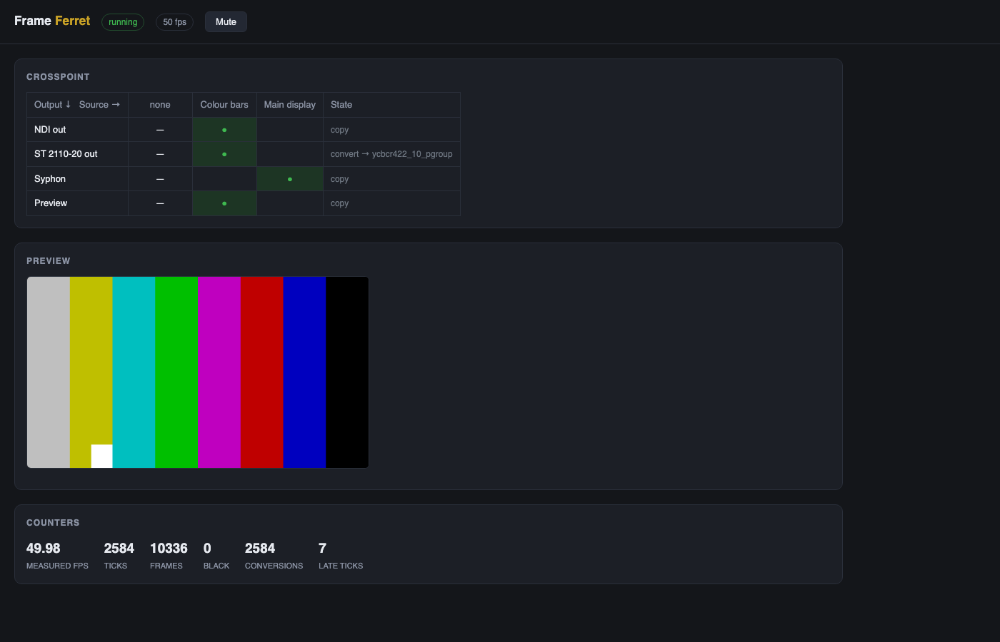

# Frame Ferret user guide

Frame Ferret is a software virtual capture card: one application that sends and receives NDI, OMT,
SRT and ST 2110 on a network interface you choose, captures this machine's screen, and shows up to
other software as a camera, a shared GPU surface, an SDI output or a web overlay.



*The control page at 50 fps: colour bars routed to the NDI, ST 2110-20 and preview outputs and the main display to Syphon (the ST 2110 row converting to 4:2:2 10-bit on the way), with the preview and the tick, frame and conversion counters underneath.*

The idea is that a protocol is just a port on a router. Anything can be a source, anything can be a
sink, and the crosspoint in the middle doesn't care which is which.

> **Before you rely on this:** a lot works and a lot isn't built yet, and the difference matters
> more here than in most projects. **NDI and OMT both work in both directions**, verified against
> separate implementations. **SRT send and receive are verified end to end**, and ST 2110-20 is
> verified against GStreamer's implementation in both directions. **DeckLink output has run on a
> real Duo 2**: 2531 frames with zero late and zero dropped by the card's own count, though the
> pixels on the wire haven't been checked.
>
> **Experimental:** the macOS virtual display (private API; see below).
>
> **Not started:** the UVC virtual camera, DeckLink capture, Spout, HTML
> output, and ST 2110 audio and ancillary. Windows and Linux build and self-test in CI but **have
> never been run interactively, and no hardware path exists on either.**
>
> This codebase was created with AI assistance, directed and reviewed by a human author.

---

## The invariant

**Every sink produces a frame, every tick.** A sink with nothing routed to it goes black and
**keeps running** rather than stopping.

That's been seen happening, not just claimed: over one 9049-tick run, 4507 frames delivered plus
4542 black is exactly 9049, one action per sink per tick, with **zero late ticks and 49.99 fps
measured**. Unrouting a sink from the browser turned its output black and kept it running at
50 fps, reporting `no source routed`.

---

## Running it

```bash
frame-ferret run
```

serves the control page. The crosspoint is clickable: sources down one axis, sinks along the other.

```bash
frame-ferret interfaces     # what NICs this machine has
frame-ferret kinds          # what node types this build has
frame-ferret selftest
```

**Bind the interface explicitly.** A stream on the wrong NIC gets diagnosed on site as a network
fault, and that's an expensive hour. Every node takes an interface.

> **NDI is the exception, and it isn't one Frame Ferret can fix.** NDI's own C API has no interface
> parameter at all, so Frame Ferret **warns** rather than pretending the setting applied.

---

## What works today

| | |
|---|---|
| **NDI send and receive** | Verified against an independent implementation, both directions. |
| **OMT send and receive** | Verified against oxbow and macOS's own `dns-sd`. |
| **SRT send and receive** | Verified end to end against an independent Rust SRT stack. |
| **ST 2110-20 send and receive** | Verified against GStreamer's RFC 4175 implementation, within 2 code values. |
| **DeckLink output** | Run on a real Duo 2 at 1080p50 in v210. |
| **Screen, window, application and region capture** (macOS) | Built and run. A region of interest is a source rect, so a crop costs nothing. |
| **Syphon output** (macOS) | Verified against Resolume's Syphon — a different implementation from the one vendored here. |
| **Virtual display** (macOS, experimental) | A display other software can output to, sent out over any sink. Run with Resolume Arena's Advanced Output into OMT. Private API — see below. |
| **Desktop launcher** | Shipped since v0.1.1. Pick an interface and a port, press Start, and it opens the control page. Closing its window hides it to the tray (the menu bar on a Mac) and leaves the engine running. |

---

## One measurement worth understanding before you report a bug

Over an NDI round trip, **saturated blue comes back 178 rather than 191.**

That's NDI's own compression, not this code: an independent sender through the same round trip
lands on exactly the same 178. The control experiment mattered, because the number on its own would
have looked like a bug in the pixel conversion.

OMT does much better through the same test (all eight bars within 2 code values), because it
carried BGRA rather than compressing it. That difference comes from the protocols, and it's a good
reason to choose one over the other.

---

## SRT needs a codec, and that is why ffmpeg is a subprocess

NDI and OMT carry raw frames, so a node is a thin wrapper over the SDK. SRT carries an MPEG
transport stream of *compressed* video, so it needs a codec.

Frame Ferret runs **ffmpeg as a subprocess** rather than linking it:

- **You point at the install you already have:** the node's own setting, `$FERRET_FFMPEG`,
  `$PATH`, or the usual locations, in that order. An explicit path that's wrong is an error, never
  a silent fallback to some other ffmpeg.
- **No ABI coupling.** libavcodec's structs change between major versions, and mirroring them by
  hand would be far more fragile than NDI, OMT or libsrt, which all expose flat C ABIs on purpose.
- **Licensing stays simple.** A separate process over a pipe doesn't raise any question an MIT
  codebase needs to answer.

Hardware encoders are used where there are any.

---

## The virtual display (macOS, experimental)

A `virtual-display` node creates a display that macOS and every application treat as a real one:
it's listed in System Settings > Displays, windows can be dragged onto it, and software that
outputs full screen to a display can choose it. Route the node to an OMT, NDI, SRT, DeckLink or
Syphon sink and whatever is on the display goes out over that.

The case it was built for is **Resolume's Advanced Output**, whose output devices are built into
the app: there's no way to add OMT to that list, but a screen whose device is a virtual display
can be sent anywhere Frame Ferret sends. `config/virtual-display.json` is the starting point:

```json
{ "id": "screen", "kind": "virtual-display", "target": "Frame Ferret Display",
  "width": 1920, "height": 1080, "rate": "60" }
```

- `target` names the display (then `label`, then "Frame Ferret"). Resolume doesn't show that
  name: it lists displays by number, so the virtual one is the "Display 2 (1920x1080)" or
  similar that appears when Frame Ferret starts. Use Output > Identify Displays to be sure.
- The display exists while Frame Ferret runs and goes when it stops. The same name gets the same
  serial number every time, so macOS remembers where it was arranged.
- It needs Screen Recording permission, like screen capture.
- **Use a whole rate** (25, 30, 50, 60). macOS runs a virtual display at whole rates only: a 59.94
  display runs at 60, and Frame Ferret warns that its capture will drop about one frame every
  17 seconds.
- The pointer isn't captured. If you move it onto the display it won't appear in the output.
- **It is private API.** macOS has no public way to create a display; this uses the same
  CoreGraphics classes as Sidecar, BetterDisplay and DeskPad. A future macOS could remove them.
  If one does, this node fails with a sentence saying so and everything else keeps working.
- Like any screen capture, it can lose a frame when the Mac is heavily loaded, because the window
  server skips composites. Run on an idle machine it was clean.

---

## What is not built

Designed and documented, but not implemented: the UVC virtual camera (it needs an embedded
provisioning profile the release harness doesn't produce yet), the Windows virtual display (an
IddCx driver needs attestation signing), DeckLink capture, Spout, HTML output, and ST 2110-30
audio and -40 ancillary.

They're left out of the UI rather than sitting there failing.

---

## If something is wrong

| Symptom | Cause |
| --- | --- |
| **A stream is on the wrong NIC** | Every node takes an interface — except NDI, whose API has no such parameter. Check for the warning. |
| **A sink is black but running** | Nothing is routed to it. That is the invariant, not a fault. |
| **Blue reads 178 over NDI** | NDI's compression. Independent senders land on the same number. |
| **SRT does nothing** | It needs an ffmpeg. Check the resolution order above; a wrong explicit path is an error rather than a silent fallback. |
| **A node type is missing** | Run `frame-ferret kinds`. Several are designed but not built — see above. |
| **The virtual display says "never made it active" or "no CGVirtualDisplay"** | The first is the window server refusing it, usually right after a macOS update; restart Frame Ferret. The second means this macOS no longer has the private classes. |
| **The virtual display is in Resolume but the output is black** | The Resolume screen isn't enabled, or the sink isn't routed to the display. A missing Screen Recording permission stops the node with a sentence rather than sending black. |
| **It does nothing on Windows or Linux** | Both build and self-test in CI and have never been run interactively. No hardware path exists on either. |
